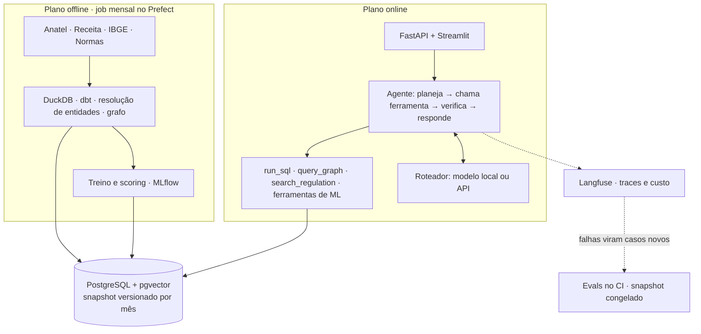

# Analista de Mercado Telecom

Agente de IA que responde, em português, perguntas analíticas sobre o mercado brasileiro de banda larga fixa, usando só dados públicos e mostrando de onde saiu cada número.

> **Em construção.** O agente v1 responde perguntas com SQL sobre dados reais até 2026-09, com um modelo local de 4B. Grafo de sócios, RAG, ferramentas de ML e deploy ainda são planos.

## O problema

Os dados do setor são públicos, mas estão espalhados: acessos por município na Anatel, quadro societário na Receita Federal, população e renda no IBGE, obrigações em resoluções da Anatel. Responder uma pergunta de mercado exige cruzar tudo isso à mão.

O sistema deve responder perguntas como:

- Quais cidades de Goiás com mais de 50 mil habitantes têm mercado pouco disputado?
- Quais grupos econômicos de provedores mais cresceram no Centro-Oeste desde 2022?
- Quanto o provedor X deve crescer em Anápolis nos próximos 12 meses?
- O que a regulação exige de um provedor de pequeno porte em relação ao atendimento?

## O que já funciona

- **56,2 milhões de linhas** da Anatel, com os 205 meses idênticos ao total oficial publicado.
- **24 GB da base do CNPJ** reduzidos ao recorte de telecom em 31 segundos depois de descompactados, sem CPFs nem contatos. O [benchmark](benchmarks/duckdb_vs_spark/README.md) mostra o DuckDB 8 vezes mais rápido que o Spark nesse job.
- **100% dos CNPJs da Anatel** ligados à Receita pela chave exata.
- **Warehouse dbt** com 51 modelos e testes, incluindo a conciliação com o total oficial e o bloqueio de CPF nos dados expostos.

- **Agente text-to-SQL** com loop próprio, busca de provedores por nome, usuário de banco somente leitura, validação de SQL e checagem de números contra os resultados.

| Execution accuracy, às cegas | Agente local (`qwen3.5:4b`) | Claude Haiku 5.5 | Claude Sonnet 5.5 |
| --- | --- | --- | --- |
| 39 perguntas novas | **54%** | 92% | 100% |

As perguntas cobrem marca comercial, erro de grafia, provedor inexistente, cidades homônimas e consultas de estrutura nova. Os modelos Claude rodaram em outras condições, descritas na [comparação de modelos](docs/eval-reports/model-selection.md). O [relatório v2](docs/eval-reports/v2.md) mostra onde o agente erra e por quê.

Ao longo do caminho, os dados mostraram que a densidade publicada pela Anatel usa população, embora a metodologia diga domicílios. Esse e outros achados estão em [Fontes de dados](docs/data-sources.md), e as colunas em [Dicionário de dados](docs/data-dictionary.md).

## Arquitetura

Um plano offline prepara tudo uma vez por mês e um plano online só consulta. O agente nunca toca os dados diretamente: tudo passa por ferramentas tipadas, o que torna o sistema seguro, testável e avaliável. A justificativa está no [ADR-001](docs/adr/001-arquitetura-geral.md).



## Como rodar

Requer [uv](https://docs.astral.sh/uv/), Docker com Compose e make.

```bash
make setup   # dependências, .env e pre-commit
make up      # sobe a stack e espera ficar saudável
make test    # testes unitários e de integração
```

Para montar o warehouse com os dados públicos, que baixam cerca de 8 GB:

```bash
make ingest     # Anatel e IBGE
make cnpj       # base do CNPJ
make transform  # carrega o Postgres e roda o dbt
make snapshot   # congela a versão atual
```

Para conversar com o agente, depois de `ollama pull qwen3.5:4b`:

```bash
make api        # API em http://localhost:8010
make ui         # tela em http://localhost:8501
make evals SPLIT=dev LABEL=teste  # roda as perguntas golden
```

O CI confere SQLs de referência, guardrails e busca de provedores, sem LLM. A suíte completa com o modelo roda localmente, porque levaria horas sem GPU. A decisão está no [ADR-006](docs/adr/006-evals-no-ci.md).

| Serviço | Endereço local |
| --- | --- |
| PostgreSQL + pgvector | `localhost:5433` |
| MLflow | <http://localhost:5000> |
| Langfuse | <http://localhost:3001> (credenciais de admin no `.env`) |

As portas ficam presas a `127.0.0.1` e podem ser trocadas no `.env`. `make help` lista todos os alvos.

## Documentação

| Assunto | Onde |
| --- | --- |
| Resultados do agente | [Relatório v2](docs/eval-reports/v2.md), [relatório v1](docs/eval-reports/v1.md) e [comparação de modelos](docs/eval-reports/model-selection.md) |
| Dados | [Fontes de dados](docs/data-sources.md) e [dicionário de dados](docs/data-dictionary.md) |
| Benchmarks | [DuckDB contra Spark](benchmarks/duckdb_vs_spark/README.md) e [Jaro-Winkler contra rapidfuzz](benchmarks/string_similarity/README.md) |

Decisões de arquitetura:

- [ADR-001](docs/adr/001-arquitetura-geral.md): arquitetura geral
- [ADR-002](docs/adr/002-warehouse-no-postgres.md): dbt no Postgres sobre dados agregados
- [ADR-003](docs/adr/003-dados-pessoais.md): dados pessoais em uma demo pública
- [ADR-004](docs/adr/004-duckdb-em-vez-de-spark.md): DuckDB em vez de Spark
- [ADR-005](docs/adr/005-ligacao-anatel-receita.md): ligação entre Anatel e Receita por chave exata
- [ADR-006](docs/adr/006-evals-no-ci.md): evals no CI sem LLM

## Roteiro

| Fase | Entrega | Situação |
| --- | --- | --- |
| 0 | Fundação: repositório, stack local e CI | concluída |
| 1 | Warehouse, agente text-to-SQL e evals | quase concluída: faltam medir o modelo grande via API e publicar o snapshot das evals |
| 2 | Grafo de sócios e RAG regulatório | planejada |
| 3 | Fine-tuning de modelo pequeno para text-to-SQL | planejada |
| 4 | Ferramentas de ML, segurança, observabilidade e deploy | planejada |
