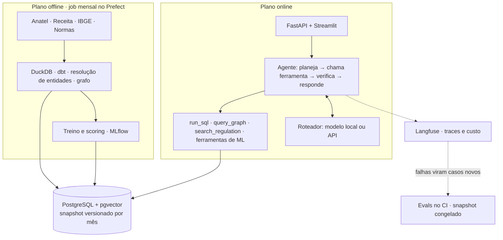

# Analista de Mercado Telecom

Agente de IA que responde, em português, perguntas analíticas sobre o mercado brasileiro de banda larga fixa, usando só dados públicos e mostrando de onde saiu cada número.

> **Em construção.** Hoje o repositório tem só a fundação: stack local, CI e arquitetura documentada. Nada abaixo sobre o agente existe ainda; as seções descrevem o que está planejado.

## O problema

Os dados do setor são públicos, mas estão espalhados: acessos por município na Anatel, quadro societário na Receita Federal, população e renda no IBGE, obrigações em resoluções da Anatel. Responder uma pergunta de mercado exige cruzar tudo isso à mão.

O sistema deve responder perguntas como:

- Quais cidades de Goiás com mais de 50 mil habitantes têm mercado pouco disputado?
- Quais grupos econômicos de provedores mais cresceram no Centro-Oeste desde 2022?
- Quanto o provedor X deve crescer em Anápolis nos próximos 12 meses?
- O que a regulação exige de um provedor de pequeno porte em relação ao atendimento?

## Arquitetura planejada

Um plano offline prepara tudo uma vez por mês e um plano online só consulta. O agente nunca toca os dados diretamente: tudo passa por ferramentas tipadas, o que torna o sistema seguro, testável e avaliável. A justificativa está no [ADR-001](docs/adr/001-arquitetura-geral.md).



## Como rodar

Requer [uv](https://docs.astral.sh/uv/), Docker com Compose e make.

```bash
make setup   # dependências, .env e pre-commit
make up      # sobe a stack e espera ficar saudável
make test    # testes unitários e de integração
```

| Serviço | Endereço local |
| --- | --- |
| PostgreSQL + pgvector | `localhost:5433` |
| MLflow | <http://localhost:5000> |
| Langfuse | <http://localhost:3001> (credenciais de admin no `.env`) |

As portas ficam presas a `127.0.0.1` e podem ser trocadas no `.env`. `make help` lista todos os alvos.

## Roteiro

| Fase | Entrega | Situação |
| --- | --- | --- |
| 0 | Fundação: repositório, stack local e CI | concluída |
| 1 | Warehouse, agente text-to-SQL e evals | planejada |
| 2 | Grafo de sócios e RAG regulatório | planejada |
| 3 | Fine-tuning de modelo pequeno para text-to-SQL | planejada |
| 4 | Ferramentas de ML, segurança, observabilidade e deploy | planejada |
